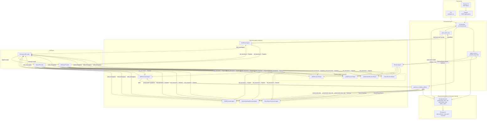
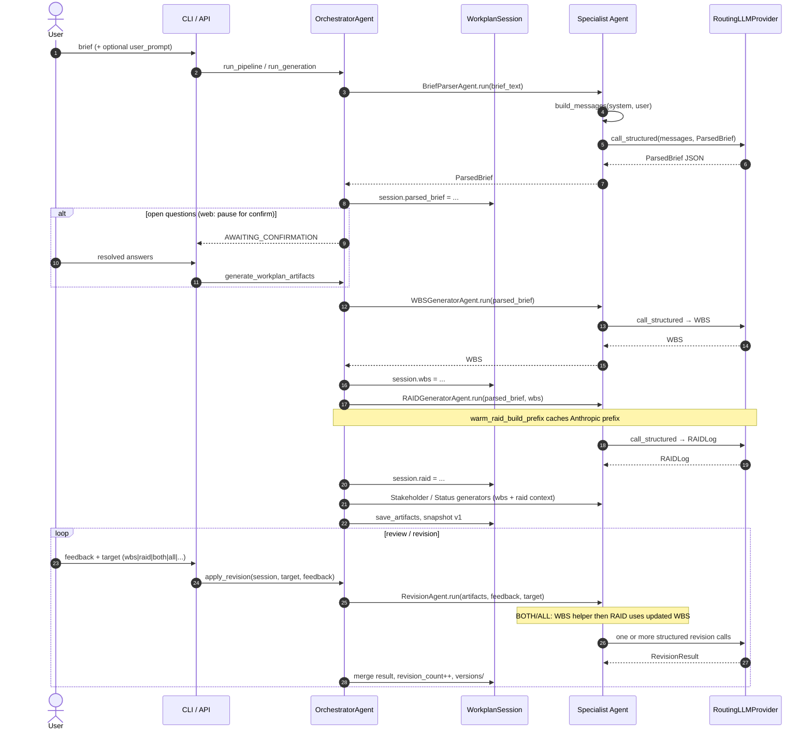
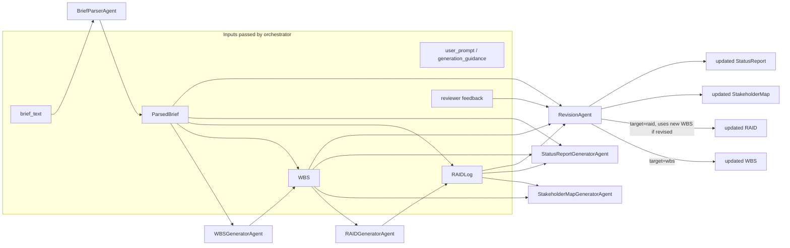

# Workplan Agent — Architecture Diagrams

Auto-generated by [`generate_architecture_graph.py`](generate_architecture_graph.py).
Re-run after orchestration or agent changes.

## Orchestration & agent wiring

## Generation & revision sequence

## Artifact data dependencies

## Notes

- **No direct agent-to-agent messaging.** Each specialist agent is stateless; `OrchestratorAgent` owns `WorkplanSession` and passes Pydantic models as arguments.
- **LLM messages** are built per call via `BaseAgent.build_messages()` → `provider.call_structured()` (routed to OpenAI or Anthropic by model name).
- **Web flow** splits parse and build: `parse_brief_only` may stop at `AWAITING_CONFIRMATION` before `generate_workplan_artifacts`.
