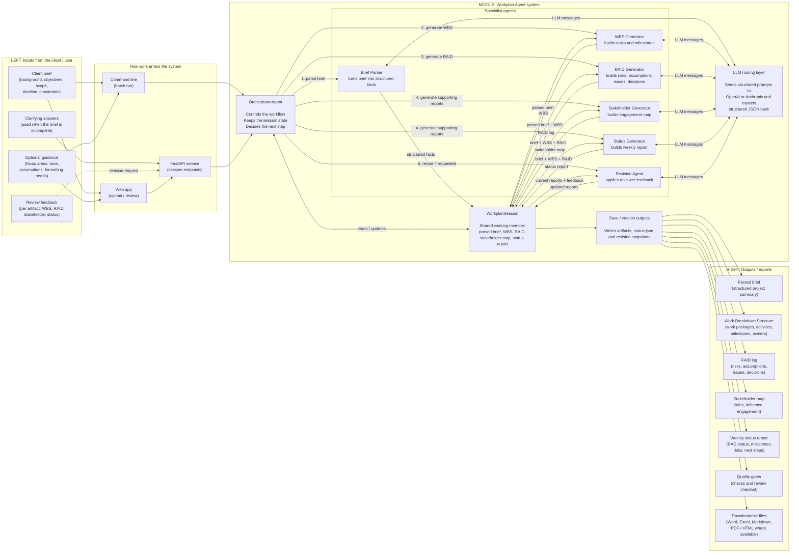
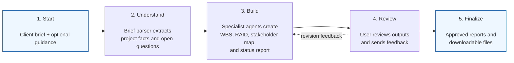

# Workplan Agent — Combined Business Overview

A more detailed plain-language view that keeps **inputs on the left** and **outputs on the right**, while still showing the main orchestration pieces. For full technical detail, see [`ARCHITECTURE.md`](ARCHITECTURE.md).

Auto-generated by [`generate_simple_architecture_graph.py`](generate_simple_architecture_graph.py).

## Inputs → Orchestration → Reports

## Business Journey

### In plain language

1. **Start** — The user provides the client brief, optional guidance, and later any clarifying answers or review feedback.
2. **Orchestrate** — `OrchestratorAgent` controls the workflow and keeps all intermediate results in `WorkplanSession`.
3. **Generate** — Specialist agents create the WBS, RAID log, stakeholder map, and weekly status report through structured LLM calls.
4. **Revise** — Feedback goes through the revision flow and updates only the requested reports.
5. **Deliver** — The system saves versioned artifacts and exports reports for download.
